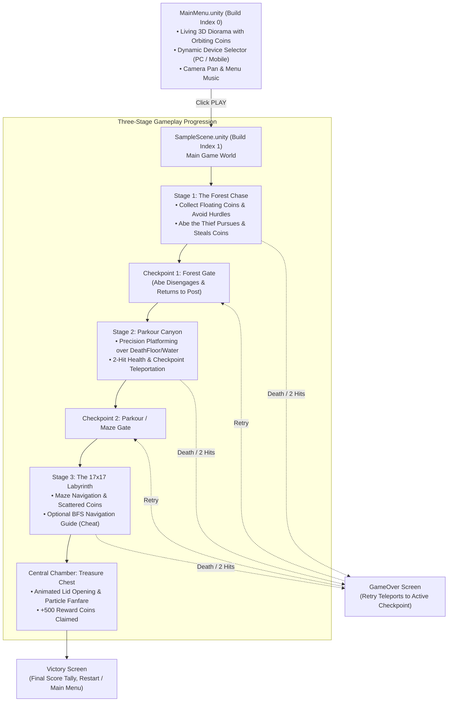

# 🪙 Coin Chase 3D: The Labyrinth Escape

A 3D First-Person Adventure, Platformer & Labyrinth game built in **Unity 6** with the **Universal Render Pipeline (URP)**. 

The game combines **survival chase mechanics**, **precision parkour platforming**, and **maze navigation** into a seamless multi-stage journey. Players collect gold coins, dodge environmental hazards, evade a persistent thief, and navigate a 17×17 labyrinth to claim the ancient treasure. The project features full **cross-platform input (PC & Mobile touch)**, **checkpoint & state recovery**, and **custom editor development tools**.

---

## 🗺️ Project Architecture & Scene Flow

The game is structured across two primary scenes configured in `EditorBuildSettings`:

---

## 🎮 The Three Gameplay Stages

### 1. Stage 1: The Forest Chase & "Abe" the Coin Thief
* **Objective:** Traverse the forest pathway, gathering floating coins while dodging physical hurdles.
* **The Threat (Abe):** An animated AI enemy named **Abe** ([`CoinThief.cs`](Assets/Scripts/CoinThief.cs)) patrols the starting region. Using `NavMeshAgent` (with direct vector fallback), Abe actively stalks and sprints toward the player. On physical or trigger contact, Abe steals coins from the player's wallet on a cooldown.
* **Checkpoint 1 (`CheckpointGate_Forest`):** Stepping into the ancient forest stone gate triggers [`Checkpoint.cs`](Assets/Scripts/Checkpoint.cs) with `stopAbeThief = true`. Abe stops pursuing immediately and returns to his initial post.

### 2. Stage 2: Parkour Canyon & The Death Floor
* **Objective:** Jump across stone pillars, platforms (`Platform_0` to `Platform_14`, `Platform_1 (1-26)`), and floating bridges.
* **The Hazard:** The chasm floor below is marked with water and a `DeathFloor` volume. Falling off results in instant death (`DieInstantly()` in [`PlayerHealth.cs`](Assets/Scripts/PlayerHealth.cs)).
* **Checkpoint 2 (`CheckpointGate_Parkour`):** Positioned immediately before the maze entrance to save progress and prevent having to repeat the canyon platforming.

### 3. Stage 3: The 17×17 Labyrinth & Central Chamber
* **Objective:** Navigate the $17 \times 17$ hedge and stone wall labyrinth (`Level3_Maze`) filled with corridors, dead ends, and coin stashes.
* **Maze Navigation Assistant (Cheat Mode):** Players can press **`[M]` / `[C]`** on PC or tap the on-screen **`CHEAT`** button on mobile. [`MazeCheatManager.cs`](Assets/Scripts/MazeCheatManager.cs) spawns a sequence of glowing, pulsing green procedural 3D arrows based on a verified 57-step Breadth-First Search (BFS) path directly to the center.
* **The Grand Treasure Finale:** At the center of the labyrinth on a double-tier dais rests the **Treasure Chest** ([`TreasureChest.cs`](Assets/Scripts/TreasureChest.cs)). Entering its trigger activates an animated sequence:
  - Chest lid smoothly rotates open (`Quaternion.Slerp`).
  - Golden sparkle particle effects erupt.
  - Chest light glows brightly and audio fanfare plays.
  - Grants **+500 bonus gold coins**.
  - Displays the Victory screen showing your final coin score.

---

## 🕹️ Controls & Dual-Platform Support

The project features a dedicated cross-platform input layer supporting both PC and mobile devices seamlessly:

| Action | PC (Keyboard & Mouse) | Mobile (Touch Screen) |
| :--- | :--- | :--- |
| **Move** | `W`, `A`, `S`, `D` | Left Dynamic Virtual Joystick |
| **Look / Camera** | Mouse Movement (Locked Cursor) | Right-Screen Touch Drag / Swipe Zone |
| **Jump** | `Spacebar` | `JUMP` On-Screen Button |
| **Sprint** | `Left Shift` (Hold) | `RUN` On-Screen Toggle Button |
| **Maze Guide Arrows** | `M` or `C` Key | `CHEAT` On-Screen Button (Top-Right) |
| **Pause / Resume** | `Escape` Key | `PAUSE` On-Screen Button (Top-Left) |

---

## 📂 Codebase & Script Architecture

### Core Gameplay & Mechanics (`Assets/Scripts/`)
- [`SUPERCharacterAIO.cs`](Assets/SUPER%20Character%20Controller/SUPER%20Character%20Controller/SUPERCharacterAIO.cs): First-person controller modified to read from both standard Unity inputs and [`MobileInputManager.cs`](Assets/Scripts/MobileInputManager.cs). Handles momentum, jumping, physics interactions, and collectible picking.
- [`PlayerHealth.cs`](Assets/Scripts/PlayerHealth.cs): Manages hit points (`maxHits = 2`), invincibility frames (`1.5s`), water/death-floor instant hazards, and the clean respawn cycle:
  - Temporarily disables `CharacterController` during teleportation to prevent physics conflicts.
  - Resets all collected world coins through `FloatingCoin.allCoins` registry.
  - Returns Abe the thief to his starting post.
  - Restores cursor lock modes appropriately for PC or Mobile.
- [`Checkpoint.cs`](Assets/Scripts/Checkpoint.cs): Saves ground-aligned coordinates for player respawning and manages thief disengagement triggers.
- [`CoinThief.cs`](Assets/Scripts/CoinThief.cs): AI enemy behavior for Abe, controlling movement, pathfinding, running animations, and coin theft logic.
- [`FloatingCoin.cs`](Assets/Scripts/FloatingCoin.cs): Collectible coin script with continuous rotation and sinusoidal bobbing ($y = y_0 + \sin(\omega t) \cdot A$). Maintains a static registry for world-state restoration upon player death.
- [`TreasureChest.cs`](Assets/Scripts/TreasureChest.cs): End-game objective that controls lid rotation, lights, audio, coin reward dispatch, and victory sequencing.
- [`MazeCheatManager.cs`](Assets/Scripts/MazeCheatManager.cs): Procedural arrow generator displaying a 57-step BFS solution from entrance $(0,8)$ to $(8,8)$, complete with animated HUD toasts and pulsing materials.
- [`MobileInputManager.cs`](Assets/Scripts/MobileInputManager.cs): Full mobile touch overlay providing dynamic floating joystick, right-half swipe camera look, on-screen action buttons, and automatic cursor management.
- [`DeviceSettings.cs`](Assets/Scripts/DeviceSettings.cs): Persistent platform selector (`PC` vs `Mobile`) using `PlayerPrefs` and auto-platform detection.
- [`UIManager.cs`](Assets/Scripts/UIManager.cs): Manages HUD elements, pause toggles, time scaling, victory screens, and game-over menus.
- [`MainMenuManager.cs`](Assets/Scripts/MainMenuManager.cs): Manages the Main Menu UI, device toggling, dynamic control helper prompts, and scene loading.
- [`MainMenuCameraPan.cs`](Assets/Scripts/MainMenuCameraPan.cs): Subtle harmonic camera sway script for the 3D menu diorama.
- [`BackgroundMusic.cs`](Assets/Scripts/BackgroundMusic.cs): Audio utility for looping background music tracks with custom volume and delay.

### Editor Automation Tools (`Assets/Scripts/Editor/`)
- [`PlayModeStartSceneSetup.cs`](Assets/Scripts/Editor/PlayModeStartSceneSetup.cs): Automatically ensures Play Mode in Unity always starts from `MainMenu.unity`, regardless of which scene is currently open.
- [`MainMenuSceneBuilder.cs`](Assets/Scripts/Editor/MainMenuSceneBuilder.cs): One-click editor tool (`Tools/Rebuild 3D Main Menu Environment`) to build the 3D menu diorama with lighting, skybox, orbiting coins, and camera targets.
- [`GateCheckpointSetup.cs`](Assets/Scripts/Editor/GateCheckpointSetup.cs): Editor tool (`Tools/Setup Gate Checkpoints`) to align and configure trigger colliders for the forest and parkour checkpoint gates.

---

## 🛠️ Tech Stack & Requirements

- **Engine:** Unity 6 (`6000.3.24f1` / URP 17.3.0)
- **Render Pipeline:** Universal Render Pipeline (URP) with Post-Processing Global Volume
- **Input:** Unity New Input System (`com.unity.inputsystem` v1.20.0) + UGUI Event System
- **Navigation:** Unity AI Navigation (`com.unity.ai.navigation` v2.0.14)
- **Audio:** Unity 3D Audio with dynamic volume management
- **Target Platforms:** PC (Windows / macOS / Linux) & Mobile (Android / iOS)
